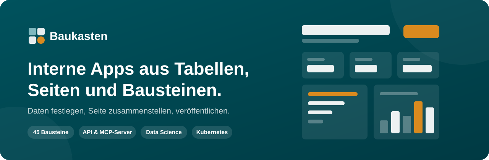
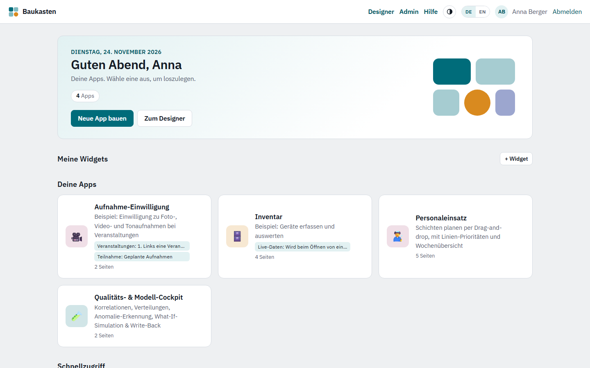
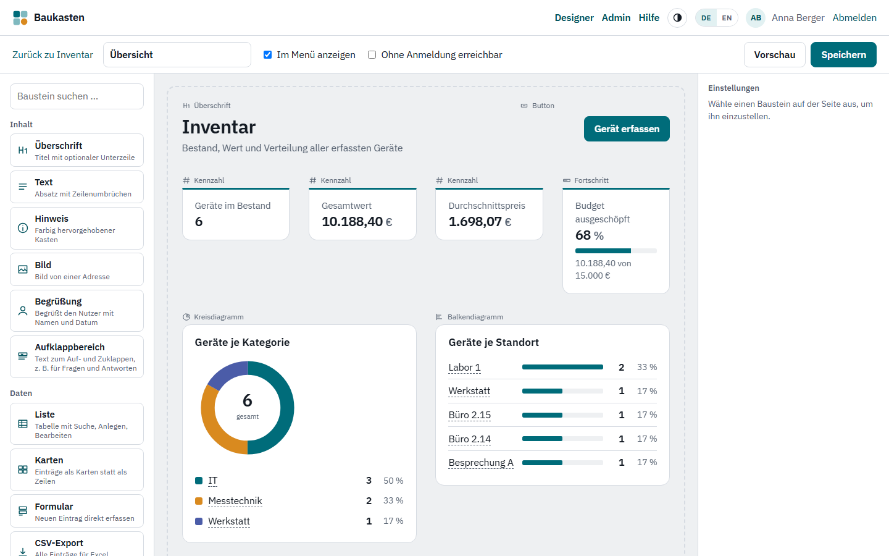
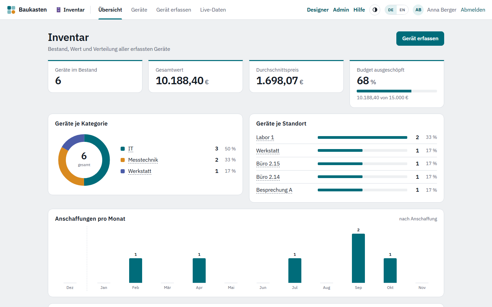
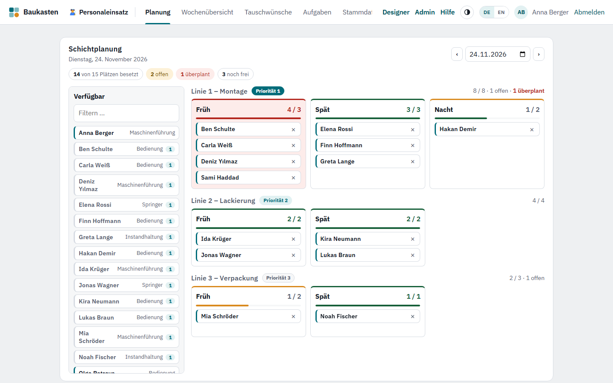
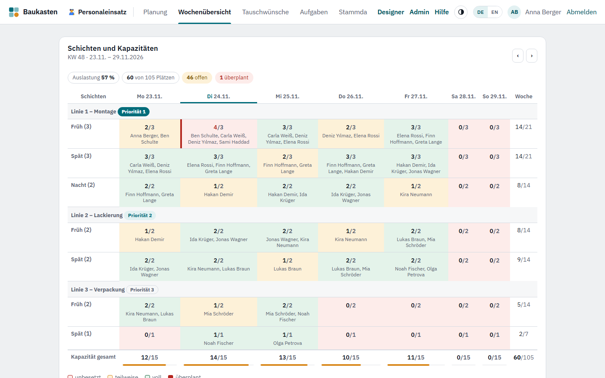
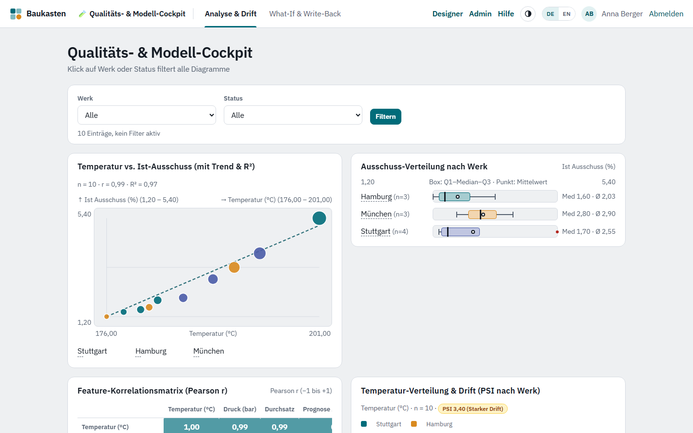
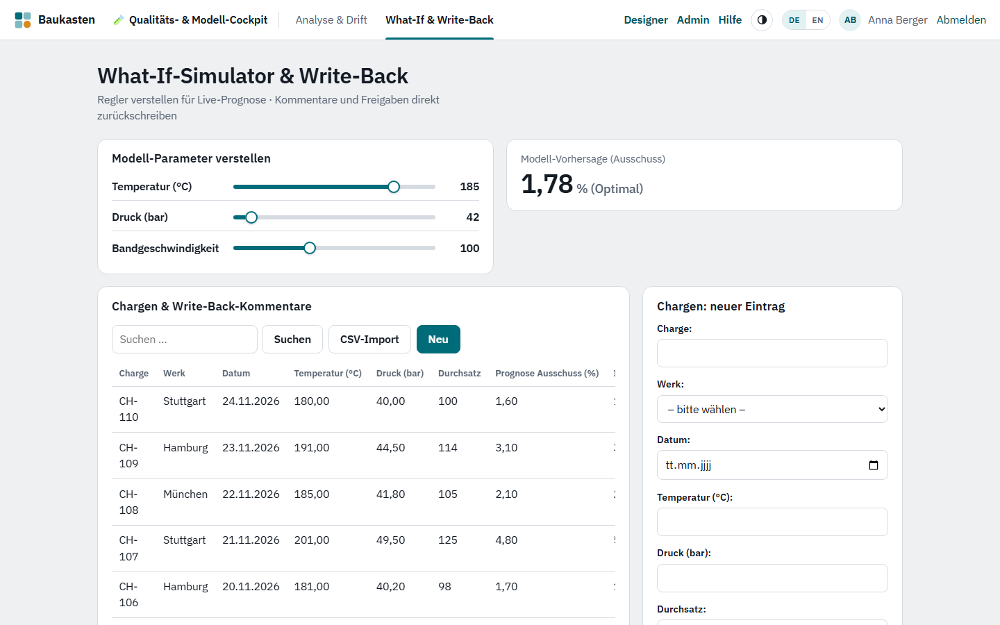

<p align="center">
  
</p>

<p align="center">
  <a href="https://github.com/Turksat46/Baukasten/actions/workflows/tests.yml"></a>
  
  
  
  
  <a href="LICENSE"></a>
</p>

<p align="center">
  <b>Fachabteilungen bauen interne Apps im Browser. Entwickler ergänzen Logik in Python.</b><br>
  Ein App-Baukasten auf Basis von Django, der auf Kubernetes läuft.
</p>

<p align="center">
  <a href="https://codespaces.new/Turksat46/Baukasten?quickstart=1"></a>
</p>

<p align="center">
  <a href="#in-fünf-minuten-starten">Schnellstart</a> ·
  <a href="#so-sieht-er-aus">Rundgang</a> ·
  <a href="#was-er-kann">Funktionen</a> ·
  <a href="docs/HANDBUCH.md">Handbuch</a> ·
  <a href="docs/HANDBOOK.en.md">English</a>
</p>

<br>

<p align="center">
  <picture>
    <source media="(prefers-color-scheme: dark)" srcset="docs/bilder/start-dunkel.png">
    
  </picture>
</p>

## Warum Baukasten?

<table>
  <tr>
    <td width="33%" valign="top">
      <h3>🧱 Bauen statt programmieren</h3>
      Tabellen festlegen, Seite aus 45 Bausteinen zusammenschieben, veröffentlichen.
      Aus jeder Tabelle wird per Klick eine fertige Seite mit Liste, Suche und Formular.
    </td>
    <td width="33%" valign="top">
      <h3>🐍 Erweiterbar in Python</h3>
      Skripte, Hooks, eigene Endpunkte und Automatisierungen mit echtem Python.
      Wenn ein Baustein fehlt, schreibt ihn ein Entwickler dazu.
    </td>
    <td width="33%" valign="top">
      <h3>🔌 Offen nach außen</h3>
      JSON-API mit Swagger, ein MCP-Server je App für KI-Agenten, Tableau in beide
      Richtungen und lesende Abfragen auf Datenbanken und Databricks.
    </td>
  </tr>
  <tr>
    <td width="33%" valign="top">
      <h3>📊 Data Science inklusive</h3>
      Streudiagramm mit Trend und R², Boxplot, Korrelationsmatrix, Histogramm mit
      Drift (PSI), What-If-Regler und Write-Back.
    </td>
    <td width="33%" valign="top">
      <h3>🔐 Für den Betrieb gemacht</h3>
      Keycloak (OpenID Connect), Gruppen und Rollen, Änderungsprotokoll über alle Wege,
      Versionen, Alarme per Teams, E-Mail oder API.
    </td>
    <td width="33%" valign="top">
      <h3>🌍 Zweisprachig</h3>
      Oberfläche auf Deutsch und Englisch. Auch die Texte jeder App lassen sich
      übersetzen, bei Bedarf per CSV.
    </td>
  </tr>
</table>

## So sieht er aus

Alle Bilder stammen aus den mitgelieferten Beispiel-Apps. Auf GitHub erscheinen sie
passend zum eingestellten hellen oder dunklen Design.

### Seiten-Designer

Bausteine per Drag-and-drop oder Tastatur anordnen, mit Vorschau auf echten Daten.

<picture>
  <source media="(prefers-color-scheme: dark)" srcset="docs/bilder/designer-dunkel.png">
  
</picture>

### Fertige App: Inventar

Kennzahlen, Diagramme und Listen; ein Klick auf einen Balken filtert die Seite.

<picture>
  <source media="(prefers-color-scheme: dark)" srcset="docs/bilder/inventar-dunkel.png">
  
</picture>

<table>
  <tr>
    <td width="50%" valign="top">
      <b>Schichtplanung per Drag-and-drop</b><br>
      <picture>
        <source media="(prefers-color-scheme: dark)" srcset="docs/bilder/planung-dunkel.png">
        
      </picture>
    </td>
    <td width="50%" valign="top">
      <b>Wochenübersicht mit Auslastung</b><br>
      <picture>
        <source media="(prefers-color-scheme: dark)" srcset="docs/bilder/woche-dunkel.png">
        
      </picture>
    </td>
  </tr>
  <tr>
    <td width="50%" valign="top">
      <b>Qualitäts- & Modell-Cockpit</b><br>
      <picture>
        <source media="(prefers-color-scheme: dark)" srcset="docs/bilder/cockpit-dunkel.png">
        
      </picture>
    </td>
    <td width="50%" valign="top">
      <b>What-If-Simulator & Write-Back</b><br>
      <picture>
        <source media="(prefers-color-scheme: dark)" srcset="docs/bilder/simulator-dunkel.png">
        
      </picture>
    </td>
  </tr>
</table>

## In fünf Minuten starten

> [!TIP]
> **Ohne Installation ausprobieren:** [In GitHub Codespaces öffnen](https://codespaces.new/Turksat46/Baukasten?quickstart=1).
> Nach ein bis zwei Minuten öffnet sich Baukasten mit allen Beispiel-Apps im Browser.
> Anmeldung: `demo` / `demo`.

Voraussetzung: Python 3.10 oder neuer.

```
python -m venv .venv
.venv\Scripts\activate            # Linux/macOS: source .venv/bin/activate
pip install -r requirements.in -r requirements-automation.in

$env:DEBUG=1                      # cmd: set DEBUG=1, Linux/macOS: export DEBUG=1
python manage.py migrate
python manage.py createsuperuser
python manage.py demo             # Beispiel-App „Inventar“; mit --neu wird sie ersetzt
python manage.py beispiel_einwilligung   # Beispiel-App „Aufnahme-Einwilligung“
python manage.py beispiel_einsatzplanung # Beispiel-App „Personaleinsatz“ mit Schichtplanung
python manage.py beispiel_datascience    # Beispiel-App „Qualitäts- & Modell-Cockpit“ (Data Science)
python manage.py runserver
```

Danach http://127.0.0.1:8000 öffnen und anmelden. Mit `DEBUG=1` legt `demo`
auch die Seite „Live-Daten“ mit einer Beispiel-Datenquelle und Skripten an.

> [!TIP]
> **Neu im Baukasten?** Im Designer startet „Einführung“ einen Begleiter, mit dem du
> in etwa 20 Minuten deine erste App selbst baust.

Für Automatisierungen, zeitgesteuerte Skripte und das Spiegeln von Abfragen in
einem zweiten Terminal: `python manage.py hintergrund --dauerhaft`.

Nach einem Update des Baukastens: `pip install -r requirements.in -r requirements-automation.in`
und `python manage.py migrate` erneut ausführen.

<details>
<summary><b>Lokal in Kubernetes</b> (Docker Desktop mit eingeschaltetem Kubernetes)</summary>

<br>

`powershell -ExecutionPolicy Bypass -File k8s\lokal\deploy.ps1 -OhneBeispiele`,
danach http://localhost:8080. Ohne `-OhneBeispiele` bricht das Skript am Ende ab,
weil die Inventar-Demo im Cluster nicht schreiben darf; die Einwilligungs-App
legt man danach mit
`kubectl -n baukasten exec deploy/baukasten -- python manage.py beispiel_einwilligung`
an. Einzelheiten im Handbuch unter „Lokal mit Kubernetes“.

</details>

<details>
<summary><b>Auf einem Raspberry Pi</b> (Zero 2 W oder größer, k3s, automatisches Ausrollen bei jedem Push)</summary>

<br>

Einmal `k8s/pi/einrichten.sh` auf dem Pi ausführen; danach baut GitHub Actions nach grünen Tests
ein arm64-Image und der Pi rollt es selbst aus. Anleitung: [k8s/pi/LIESMICH.md](k8s/pi/LIESMICH.md).

Für den ersten Pi Zero / Zero W (ARMv6, kein Kubernetes möglich) gibt es eine Variante ohne Container
mit SQLite, die ebenfalls nach jedem grünen Push selbst aktualisiert: [pi-zero/LIESMICH.md](pi-zero/LIESMICH.md).

</details>

## Was er kann

### Apps bauen

- **Daten → fertige App:** Tabellen und Felder festlegen (inklusive **berechneter Formelspalten** wie `preis * menge`), daraus entsteht per
  Klick eine Seite mit Liste, Suche, Anlegen, Bearbeiten und Löschen.
- **Seiten-Designer:** 45 Bausteine per Drag-and-drop, Tastatursteuerung und Überschreib-Schutz (`409 Conflict`), mit Vorschau auf echten
  Daten: Listen, Karten, Formulare, Kennzahlen, Diagramme, Verlauf, Export, Eingabefelder mit Schiebereglern, Filterleiste,
  Cross-Filtering per Klick, Kalender, Checkliste, Einsatzplanung per Drag-and-drop, Wochenübersicht, Kanban …
- **Startseite mit persönlichen Widgets:** Kennzahlen, Diagramme, Abfragen und eigene Bausteine aus beliebigen Apps auf der eigenen Startseite anpinnen („Meine Widgets“).
- **Öffentliche Seiten:** einzelne Seiten „ohne Anmeldung erreichbar“ machen, etwa
  für Anmeldeformulare oder Einwilligungen von Externen. Gäste dürfen nur
  Formulare und Skript-Buttons dieser Seite benutzen; mit Anfragebegrenzung.
- **Eigene Bausteine:** HTML-Bausteine mit eigenen Einstellungen und
  wiederverwendbare Vorlagen, ohne Programmierung.
- **Versionen & App-Klonen:** Stand einer App speichern, **Unterschiede zum aktuellen Stand (Versions-Diff)** vor dem Wiederherstellen prüfen, als Datei
  exportieren, importieren oder eine bestehende App per Klick als neuen Entwurf **duplizieren**.
- **Übersetzbare Apps:** alle Texte einer App (Namen, Felder, Auswahlwerte,
  Seiten, Bausteine) im Designer übersetzen, auch per CSV für Übersetzer.
  Gespeicherte Daten, API und Skripte bleiben unverändert.

### Data Science

- Liniendiagramme mit $\pm 1\,\sigma$-Band und Anomalien, **Streudiagramm mit Trendlinie & $R^2$**, **Boxplot & Ausreißer**,
  **Heatmap & Korrelationsmatrix**, **Histogramm & Data-Drift (PSI)** und **Vega-Lite-Spec-Charts**.
- **Datenbanken und Databricks:** lesende Abfragen live in Tabellen oder direkt in Data-Science-Diagrammen anzeigen (mit
  automatischer Aktualisierung und CSV-Export) oder regelmäßig in eine Tabelle spiegeln.
- **Tableau (bidirektional):** Dashboards von Tableau Server oder Tableau Cloud einbetten, mit
  Filtern aus der Seite, Rückfilterung aus Tableau-Auswahlen (`selection_map` → Baukasten-Seite/Write-Back) und optionaler Anmeldung über eine Connected App.

### Logik & Automatisierung

- **Skripte in Python und JavaScript:** Bausteine füllen, rechnen, Einträge
  prüfen, zeitgesteuert im Hintergrund arbeiten (mit Überschreib-Schutz bei gleichzeitiger Bearbeitung). Python läuft abgeschottet auf
  dem Server, JavaScript in einer Sandbox im Browser. Python-Skripte haben
  außerdem `session` (Merkzettel je Besucher, auch ohne Konto) und `token()`
  für geheime Links.
- **Automatisierungen & Fehler-Alarmierung:** Zweite App-Art ohne Seiten, nur Python-Skripte im
  Hintergrund, mit echtem Python und allen Bibliotheken einer gemeinsamen
  Umgebung. Zeitgesteuert, täglich, ständig laufend (mit Neustart) oder per
  Webhook/MCP; nie zwei Läufe eines Skripts gleichzeitig, Zeitlimit bis 4 Stunden,
  Live-Protokoll und Stoppen im Designer, Geheimnisse über `secret("NAME")`. Bei Fehlern in Automatisierungen, Zeitplan-Skripten oder Datenquellen-Abgleichen optionale **Alarmierung über Microsoft Teams (Webhook), E-Mail oder API-Call (HTTP POST)**.
- **Python-Erweiterungen:** Aktionen, Hooks, Bausteine und Endpunkte im Ordner
  `extensions/`.

### Schnittstellen & KI

- **API:** JSON-Schnittstelle je Tabelle mit Schlüsseln; eigene Endpunkte in Python.
  Dokumentation je App mit Swagger zum Ausprobieren und OpenAPI-Datei.
- **Berichte aus n8n, Teams und Copilot:** Agenten schicken dieselbe Nachricht wie an Teams
  (HTML, Markdown, Adaptive Card, MessageCard, Graph) an `/api/v1/<app>/<tabelle>/eingang/`;
  der **Berichte-Feed** zeigt sie mit Emojis, Tabellen und eingebetteten Diagrammen.
- **Python-Bibliothek** `baukasten-client` für die API, mit denselben Befehlen
  wie in Skripten (`clients/python/`).
- **MCP-Server je App** (`/mcp/<app>/`): KI-Agenten wie n8n, Claude oder Cursor
  nutzen die freigeschalteten Tabellen als Werkzeuge. Die Tools entstehen
  automatisch aus den Tabellen; ein Schlüssel ohne Schreibrecht bekommt nur die
  lesenden.
- **Apps mit KI bauen:** Eine KI deiner Wahl (Claude, Cursor, n8n …) legt über
  den MCP-Server `/mcp/designer/` Apps an und ändert sie, mit einem persönlichen
  KI-Zugang aus der Profilseite und genau deinen Rechten. Verständliche
  Prüfmeldungen, Version vor jeder Änderung; veröffentlichen und Skripte
  einschalten bleibt Sache eines Menschen.

### Betrieb & Sicherheit

- **Anmeldung:** lokale Konten oder Keycloak (OpenID Connect) mit Gruppen und
  Designer-Rolle; Standardgruppe „Viewer“ für jede Person (einstellbar über `DEFAULT_USER_GROUPS`).
- **Mitbearbeiter:** Wer eine App anlegt, ist Eigentümer/in und lädt weitere
  Designer oder Gruppen ein. Andere Designer sehen fremde Apps im Designer nicht.
- **Änderungsprotokoll:** wer wann was geändert hat, je App und je Eintrag, über alle Wege
  (Oberfläche, API, KI, Skripte, Automatisierungen); mit Suche, CSV-Export und
  Aufbewahrungsfrist.
- **Verwaltung nach Apps:** in `/admin/` alle Daten je App mit echten Spalten;
  Admins erreichen sie direkt über „Admin“ in der Kopfzeile.
- **Profilseite** mit eigenen Apps, API-Schlüsseln, Skripten und deren Fehlern.
- **Zweisprachig** (Deutsch und Englisch, umschaltbar), **Führung für neue Nutzer**,
  Platz für das Firmenlogo, Design über Variablen, helles und dunkles Design.
- **Handbuch in der Oberfläche** unter „Hilfe“ (Quelle: `docs/HANDBUCH.md`).

## Wo was steht

| Thema | Ort |
|---|---|
| Benutzen, Apps bauen, Bausteine, Versionen | [Handbuch](docs/HANDBUCH.md) Teil 1 und 2 |
| Datenquellen und Skripte anwenden | Handbuch Teil 2 |
| Öffentliche Seiten, Übersetzungen, Mitbearbeiter, Automatisierungen | Handbuch Teil 2 und „Rechte“ |
| Hintergrunddienst, Geheimnisse und Bibliotheken für Automatisierungen | Handbuch „Hintergrundarbeiten“, `requirements-automation.in` |
| Skript-Referenz, Python-Bibliothek, API, MCP-Server, Aufbau des Codes | Handbuch Teil 3 |
| Kubernetes, Datenquellen einrichten, Keycloak, Sicherheit | Handbuch Teil 4 |
| Firmenlogo einbinden | `builder/static/builder/brand/LIESMICH.txt` |
| Farben und Schrift | `builder/static/builder/theme.css` |
| Beispiele für Erweiterungen | `extensions/beispiel.py` |
| Kubernetes-Manifeste | `k8s/` |
| Aufbau, Abläufe, Diagramme | [`docs/TECHNISCHE_DOKUMENTATION.md`](docs/TECHNISCHE_DOKUMENTATION.md) |
| Betrieb: Zuständigkeiten, Updates, Sicherung, Störfälle, Alarme | [`docs/BETRIEB.md`](docs/BETRIEB.md) |
| Warum etwas so gebaut ist | [`docs/adr/`](docs/adr/) |
| Was sich geändert hat | [`CHANGELOG.md`](CHANGELOG.md) |

## Stand

Version 1.0.0 (siehe [`CHANGELOG.md`](CHANGELOG.md)). 325 automatische Tests laufen bei jeder Änderung
in GitHub Actions gegen SQLite und PostgreSQL, dazu Durchläufe im Browser. Docker-Build und die lokalen Manifeste laufen auf Kubernetes in Docker
Desktop mit PostgreSQL 16. Nicht getestet: ein echter Produktions-Cluster (Ingress,
TLS), der vollständige Login gegen einen echten Keycloak und Verbindungen zu
echten Datenbanken außer SQLite und PostgreSQL, auch nicht zu Databricks. Alle
bekannten Grenzen stehen im Handbuch unter „Grenzen des jetzigen Stands“.

## Lizenz

[MIT](LICENSE)
